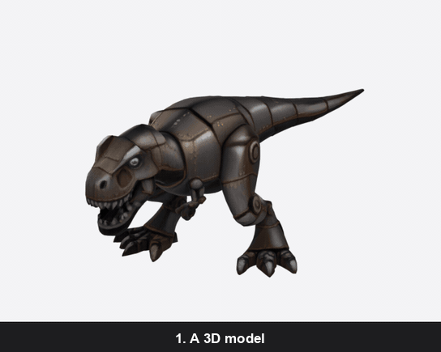
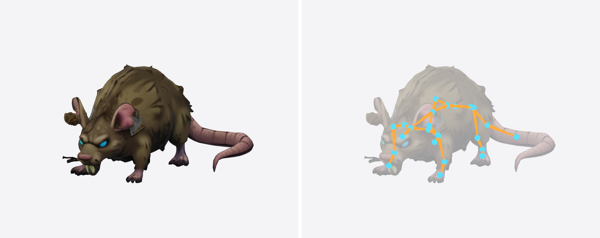

# UniRigMCP

[](https://github.com/digitalblack210/UniRigMCP/actions/workflows/ci.yml)
[](LICENSE)


Give an AI agent a 3D model and get it back with a skeleton. This is a small
[Model Context Protocol](https://modelcontextprotocol.io) server that runs
[UniRig](https://github.com/VAST-AI-Research/UniRig) on your own NVIDIA card, so an agent such
as Claude Code or Codex can rig a character as one step of a larger job. Nothing is uploaded
and there is no cost per model.



*This server does step 2. The model in step 1 was made from one picture with Microsoft's
TRELLIS ([TrellisMCP](https://github.com/digitalblack210/TrellisMCP) is that step as a server),
but any model works as input. Step 3 is a short Blender script that turns each bone in turn,
because UniRig rigs a model and does not animate it.*

It is an unofficial wrapper. UniRig is the work of Tsinghua University and VAST (Tripo); its
code is MIT-licensed. This repo holds no UniRig code or weights: the install script fetches
them. Check the terms of the weights yourself before shipping anything rigged with them.

## What you need

- An NVIDIA GPU. Tested on an RTX 5060 Ti with 16 GB; less has not been tried.
- Linux, or Windows with WSL 2 (tested on Ubuntu 24.04 under WSL).
- About 12 GB of disk for UniRig, plus 5.5 GB for its weights, which download to the Hugging
  Face cache the first time a model is rigged. That first run took 3.5 minutes here.
- Python 3.10 or newer for the server itself.

## Install

1. Get this repo and install UniRig. On Windows run the install inside WSL; it needs no sudo
   and is safe to rerun.

   ```bash
   git clone https://github.com/digitalblack210/UniRigMCP.git
   cd UniRigMCP
   bash scripts/install.sh
   ```

   It installs into `~/unirig`. Set `UNIRIG_HOME` first to put it somewhere else, and set the
   same variable for the server.

2. Install the server's one dependency. On Windows do this in Windows, not WSL.

   ```bash
   python -m venv .venv
   .venv/Scripts/pip install -r requirements.txt     # Linux: .venv/bin/pip
   ```

3. Tell your agent about it. `UNIRIG_MCP_ROOTS` lists the folders the server may read models
   from and save results to, separated by `;`. It refuses every other path.

   Claude Code, in a project's `.mcp.json`:

   ```json
   {
     "mcpServers": {
       "unirig": {
         "command": "C:\\UniRigMCP\\.venv\\Scripts\\python.exe",
         "args": ["C:\\UniRigMCP\\server.py"],
         "env": { "UNIRIG_MCP_ROOTS": "C:\\MyGame\\models" }
       }
     }
   }
   ```

   Codex, in `~/.codex/config.toml`:

   ```toml
   [mcp_servers.unirig]
   command = "C:\\UniRigMCP\\.venv\\Scripts\\python.exe"
   args = ["C:\\UniRigMCP\\server.py"]
   env = { UNIRIG_MCP_ROOTS = "C:\\MyGame\\models" }
   tool_timeout_sec = 90
   ```

## The tools

| Tool | What it does |
|---|---|
| `start_rig(model, seed=None)` | Starts a job and returns at once with a `job_id`. |
| `get_rig(job_id, wait_seconds=45, save_to=None)` | Waits up to 50 s, then reports. Call again while `status` is `running`. |
| `list_rigs(limit=10)` | Recent jobs, newest first. |
| `list_bones(model)` | The bones in any GLB, each with its parent. Needs no GPU. |

A normal run is one `start_rig`, then `get_rig` two or three times. Jobs are started and
polled, not awaited, because rigging takes longer than most clients let one tool call run.

`model` is an absolute path to a GLB, glTF, FBX, OBJ or VRM file under an allowed folder. A
finished job gives paths to the rigged GLB, the two intermediate FBX files and UniRig's log,
plus the bone list. `save_to` copies the rigged GLB into a folder of your choosing.

## What to expect

Measured on the RTX 5060 Ti:

| Model | File | Time | Bones |
|---|---|---|---|
| Mechanical T. rex (above) | 3.8 MB | 69 s | 34 |
| Rat | 1.6 MB | 75 s | 24 |



*Left: the model as handed to `start_rig`. Right: what came back. Spine, neck, a jaw bone,
both arms and both legs down to the toes are there. The long tail got only three bones.*

- **It rigs; it does not animate.** You get a posable model. Clips are made afterwards, in
  Blender or a game engine.
- **Bones are named `bone_0`, `bone_1`, ...** Work out which is the spine and which is a leg
  from the parent links in the bone list.
- **Check what each bone moves before animating it.** On the T. rex the two shoulder bones
  were given most of the chest, so turning them pulled the belly about; the forearm bones
  moved only the arms. In the clip above the shoulders barely turn for that reason.
- **The skeleton is sampled.** The same model with another `seed` can come back with a
  different layout. When a limb is missing or misplaced, try another seed before anything else.
- **One job at a time.** A second `start_rig` while one is running is refused with a message
  saying so.
- **A failed job reports the end of UniRig's log** in `error`, so the agent can see whether it
  ran out of memory, could not read the file, or something else.

## Layout

```
server.py            the MCP server; also importable for tests
scripts/install.sh   UniRig install for RTX 50-series cards
scripts/rig.sh       the three UniRig steps for one model
tests/               run with: python -m pytest
docs/                the clip and picture above
jobs/                one folder per job (ignored by git)
```

Job state lives in `jobs/<id>/job.json`, so a job keeps running and stays readable if the
server or the agent restarts. Set `UNIRIG_MCP_JOBS` to keep jobs somewhere else.

## Licence

The code in this repo is under the [MIT licence](LICENSE). That covers this wrapper only:
UniRig and its weights carry their own terms.
